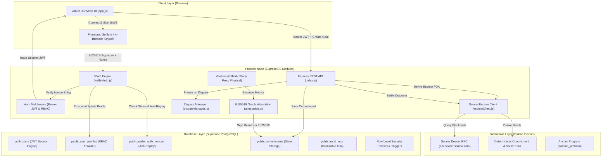
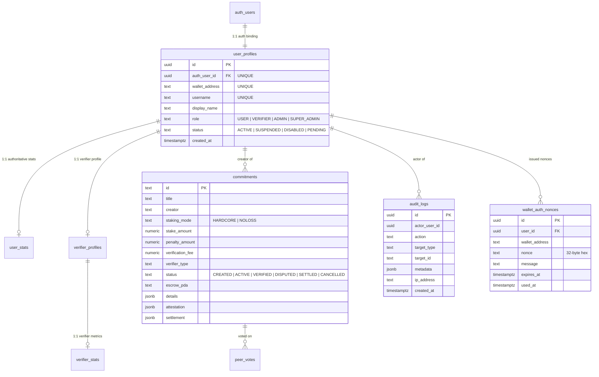

# COMMIT PROTOCOL — COMPREHENSIVE PROJECT AUDIT & ARCHITECTURAL REPORT

**Document Version:** 1.0.0-AUDIT  
**Audit Date:** 2026-10-11  
**Auditor:** Senior Software Architect, Security Auditor & Solana Systems Engineer  
**Repository Revision (Git Commit):** `8490197fd444c10128ab9d203945cf86c91754e6`  
**Target File Path:** `docs/PROJECT_AUDIT_REPORT.md`  
**Audit Scope:** Full repository source code, Anchor smart contracts, backend Express API, Supabase PostgreSQL schema & RLS policies, cryptographic oracle subsystems, verifier engines, frontend Web3 client, automated test suites, adversarial security batteries, and live runtime behavior.

---

## 1. Report Title, Date, Repository Revision, and Audit Scope

* **Project Name:** Commit (Commit Protocol)
* **Date:** October 11, 2026
* **Repository Revision:** `8490197fd444c10128ab9d203945cf86c91754e6`
* **Local Workspace Root:** `d:\Hackthon`
* **Scope of Audit:**
  1. **Smart Contracts:** Rust / Anchor program located in [`programs/commit-protocol/src/lib.rs`](file:///d:/Hackthon/programs/commit-protocol/src/lib.rs).
  2. **Application Server:** Node.js (v20+ ES Modules) Express server, REST endpoints, and orchestration in [`server/index.js`](file:///d:/Hackthon/server/index.js).
  3. **Authentication & Authorization Subsystem:** Sign-in-with-Solana (SIWS) implementation, Ed25519 signature checks, JWT session issuance, and RBAC middleware in [`server/auth/`](file:///d:/Hackthon/server/auth/).
  4. **Database & Data Layer:** PostgreSQL schemas, triggers, and Row Level Security (RLS) policies in [`supabase_schema.sql`](file:///d:/Hackthon/supabase_schema.sql), [`supabase_auth_schema.sql`](file:///d:/Hackthon/supabase_auth_schema.sql), and [`scripts/harden_rls.sql`](file:///d:/Hackthon/scripts/harden_rls.sql).
  5. **Verification Engines & Oracle:** GitHub commit verifier, Deep Work rotating-nonce study timer, and Peer Consensus engine in [`server/verifiers/`](file:///d:/Hackthon/server/verifiers/) and [`server/oracle/attestation.js`](file:///d:/Hackthon/server/oracle/attestation.js).
  6. **Solana Escrow & Blinks:** Escrow client in [`server/solana/escrowClient.js`](file:///d:/Hackthon/server/solana/escrowClient.js) and Solana Actions spec in [`server/blinks/actions.js`](file:///d:/Hackthon/server/blinks/actions.js).
  7. **Frontend Web3 Application:** Vanilla JS, CSS design system, and HTML components in [`public/`](file:///d:/Hackthon/public/).
  8. **Testing & QA Suites:** All unit, integration, adversarial security, and end-to-end suites in [`tests/`](file:///d:/Hackthon/tests/).

---

## 2. Executive Summary

### 2.1 What Commit Does
Commit is a decentralized financial commitment and verification platform built on the Solana blockchain. Users lock capital (USDC or SOL) into escrows to bind themselves to measurable real-world goals (e.g., shipping code to GitHub, completing focused deep-work study blocks, or accomplishing physical real-world milestones). Evidence is evaluated through automated oracles, cryptographic session monitors, peer consensus quorums, or accredited human verifiers. Upon objective evaluation, funds are returned to the user or forfeited according to predefined smart-contract rules.

### 2.2 The Problem Solved
Traditional commitment devices (such as StickK or Beeminder) suffer from catastrophic user churn because humans inherently loathe losing money, and verification either relies on easily gamed honor systems or logistically impossible physical inspections ($1 task travel). Commit solves this with:
1. **Dual Staking Models:** Introducing a "No-Loss" staking tier where principal remains preserved in lending vaults while only accrued yield is at stake, alongside a "Hardcore" principal-at-risk tier.
2. **Cryptographic Anti-Cheating Verification:** Using dynamic Solana blockhash challenge codes (`SOL-xxxxxx`) for photos/videos, continuous rotating heartbeat nonces for study sessions, and commit-tree SHA parsing for GitHub.
3. **Pure Web3 Sign-in-With-Solana (SIWS):** Eliminating email/password friction while maintaining PostgreSQL RLS security.
4. **Solana Blinks (Dialect Actions):** Allowing 1-click commitment creation and funding directly inside Twitter/X feeds and messaging apps.

### 2.3 Current Development Stage
**Stage: Advanced Working Prototype / Pre-Deployment Alpha.**  
- **Backend & APIs:** Production-grade implementation with comprehensive test coverage.
- **Database & Security:** Hardened PostgreSQL schema with Row Level Security and trigger-level privilege escalation prevention.
- **Cryptographic Oracles:** Fully operational Ed25519 signature scheme and SHA-256 evidence hashing.
- **Smart Contracts:** Complete Anchor Rust program written, but current settlement execution in the backend client is running via **simulated transaction execution** with real Devnet RPC queries rather than a deployed on-chain program.

### 2.4 Major Working Features
- Pure Solana Connect Wallet authentication (SIWS) with 32-byte nonces, Ed25519 verification, and Supabase JWT issuance.
- Legacy auth retirement (returns `HTTP 410 Gone` with `WALLET_AUTH_REQUIRED`).
- Automated GitHub Verifier filtering merge commits and duplicate SHAs.
- Deep Work Study Focus timer with continuous rotating challenge nonces and server-accumulated active duration.
- Peer Consensus engine with dynamic Solana blockhash challenges and 2-of-3 threshold voting.
- Authoritative Verifier Subsystem with ephemeral 5-minute QR check-in codes, conflict-of-interest prevention, and evidence checklist locks.
- Formal Dispute resolution lifecycle with active settlement freezes and admin overturn/uphold controls.
- Solana Actions / Blinks spec compliance (`/actions.json` and `/api/actions/commit`).

### 2.5 Major Incomplete or Broken Features
1. **On-Chain Anchor Deployment (Simulated Settlement):** [`server/solana/escrowClient.js`](file:///d:/Hackthon/server/solana/escrowClient.js) derives genuine PDAs and queries live Devnet blockhashes, but its `executeSettlement()` method generates a deterministic 64-byte mock transaction signature for the explorer URL instead of invoking on-chain instructions via CPI.
2. **Kamino/MarginFi Yield Adapter Integration:** "No-Loss" staking logic is tracked at the protocol level, but on-chain deposit CPIs into Kamino or MarginFi lending pools are not implemented on Devnet.
3. **Live GitHub API Token Integration:** Relies on unauthenticated GitHub REST requests, which fallback to deterministic mock commits if rate-limited.
4. **Automated Headless Browser UI Testing:** Tests are 100% backend Node.js fetch suites; zero Playwright/Cypress end-to-end browser tests exist.

### 2.6 Overall Readiness Assessment
* **Local Development & Demo:** **10 / 10** (Ready immediately)
* **Solana Devnet Evaluation:** **8.5 / 10** (Ready for demo using built-in evaluators and Devnet blockhashes; settlement is simulated)
* **Production with Real Mainnet Funds:** **4.0 / 10** (Not production-ready until Anchor program is deployed, audited, and real SPL token vaults are wired)

### 2.7 Top Five Most Important Next Actions
1. **Deploy Anchor Program to Solana Devnet:** Build and deploy `commit_protocol` using `anchor deploy` to a Devnet program ID.
2. **Wire Real SPL-Token Escrow Transfers:** Replace simulated settlement in [`server/solana/escrowClient.js`](file:///d:/Hackthon/server/solana/escrowClient.js) with real Solana web3.js transaction instructions.
3. **Configure GitHub OAuth / Personal Access Tokens:** Add authenticated GitHub API headers to eliminate rate-limit fallbacks.
4. **Implement Browser UI E2E Test Suite:** Introduce Playwright tests to validate client-side modal interactions and wallet adapter popups.
5. **Connect Kamino / MarginFi Yield Vault CPI:** Connect real liquidity pool deposit/withdraw CPIs for the No-Loss staking mode.

---

## 3. Project Overview and Value Proposition

```
┌─────────────────────────────────────────────────────────────────────────────────────────┐
│                                    COMMIT PROTOCOL                                      │
│                           "Put Money Behind Your Promise"                               │
├────────────────────────────┬─────────────────────────────┬──────────────────────────────┤
│      CREATOR / USER        │     VERIFICATION ENGINE     │       FINANCIAL ESCROW       │
├────────────────────────────┼─────────────────────────────┼──────────────────────────────┤
│ • Sign in via Phantom/Sol. │ • GitHub Commit SHA Engine  │ • Hardcore Escrow Vault      │
│ • Configure Goal & Stake   │ • Deep Work Timer (Nonces)  │ • No-Loss Yield Vault        │
│ • Fund Escrow via PDA      │ • 2/3 Peer Blockhash Quorum │ • Ed25519 Oracle Attestation │
│ • Submit Cryptographic Proof│ • Accredited QR Inspectors │ • Automated Settlement       │
└────────────────────────────┴─────────────────────────────┴──────────────────────────────┘
```

Commit bridges behavioral economics and blockchain guarantees. Traditional commitment contracts fail because central platforms cannot cost-effectively or trustworthily verify real-world progress. Commit provides cryptographic proofs of work and decentralized incentives, guaranteeing that neither the creator nor the platform can arbitrarily seize or withhold funds without signed attestation evidence.

---

## 4. Actual Technology Stack

| Layer | Component | Actual Technology & Version | Verification Evidence |
| :--- | :--- | :--- | :--- |
| **Backend Runtime** | Node.js | v20+ (ES Modules, `"type": "module"`) | [`package.json:6`](file:///d:/Hackthon/package.json#L6) |
| **Backend Framework**| Express | `^4.19.2` | [`package.json:19`](file:///d:/Hackthon/package.json#L19) |
| **Blockchain SDK** | Solana Web3.js | `@solana/web3.js: ^1.95.3` | [`package.json:14`](file:///d:/Hackthon/package.json#L14) |
| **Token Standard** | Solana SPL Token | `@solana/spl-token: ^0.4.8` | [`package.json:13`](file:///d:/Hackthon/package.json#L13) |
| **Smart Contract** | Anchor Framework | Rust `anchor-lang = "0.30.1"`, Solana Program `1.18.26` | [`programs/commit-protocol/Cargo.toml:19`](file:///d:/Hackthon/programs/commit-protocol/Cargo.toml#L19) |
| **Database & Auth** | Supabase / PostgreSQL | `@supabase/supabase-js: ^2.117.2` | [`package.json:15`](file:///d:/Hackthon/package.json#L15) |
| **Cryptography** | TweetNaCl & Base58 | `tweetnacl: ^1.0.3`, `bs58: ^6.0.0` | [`package.json:16-20`](file:///d:/Hackthon/package.json#L16-L20) |
| **Frontend Framework**| Vanilla HTML5 / ES6 | Custom Modular Component Loader, Vanilla CSS | [`public/js/component-loader.js`](file:///d:/Hackthon/public/js/component-loader.js) |
| **Browser Crypto** | In-Browser TweetNaCl| `nacl-fast.min.js` | [`public/js/nacl-fast.min.js`](file:///d:/Hackthon/public/js/nacl-fast.min.js) |
| **Styling & Design** | Pure Vanilla CSS | Custom Solana Dark Obsidian / Emerald / Purple Design System | [`public/css/style.css`](file:///d:/Hackthon/public/css/style.css) |
| **Environment** | Dotenv | `dotenv: ^16.4.5` | [`.env`](file:///d:/Hackthon/.env) |

### Required Environment Variables
The following environment variables are required to operate the protocol node:
* `PORT` (e.g., `3000`)
* `APP_URL` / `APP_ORIGIN` (e.g., `http://localhost:3000`)
* `SUPABASE_URL` (Supabase Project URL)
* `SUPABASE_ANON_KEY` (Supabase Anonymous Client Key)
* `SUPABASE_SERVICE_ROLE_KEY` (Supabase Service Role Key for Admin operations)

---

## 5. Repository Structure

```
D:\Hackthon\
├── .env                             # Environment configuration (Keys named only)
├── .env.example                     # Reference environment variables
├── package.json                     # NPM dependencies & test script entry points
├── programs/
│   └── commit-protocol/             # Solana Anchor Smart Contract
│       ├── Cargo.toml               # Anchor 0.30.1 & SPL dependencies
│       └── src/
│           └── lib.rs               # Production Anchor Rust Program (605 lines)
├── server/
│   ├── index.js                     # Main Express server & API routes (1,267 lines)
│   ├── auth/
│   │   ├── middleware.js            # JWT verification & RBAC authorization gates
│   │   ├── routes.js                # Wallet challenge/authenticate & retired auth routes
│   │   ├── supabase.js              # Supabase admin and anonymous client singletons
│   │   └── walletAuth.js            # SIWS challenge generation & Ed25519 cryptographic auth
│   ├── blinks/
│   │   └── actions.js               # Solana Actions & Blinks specification handler
│   ├── db/
│   │   └── supabase.js              # Database sync layer & fallback mapping
│   ├── disputes/
│   │   └── disputeManager.js        # Formal dispute resolution lifecycle & freezing engine
│   ├── notifications/
│   │   └── notificationManager.js   # Event notification engine
│   ├── oracle/
│   │   └── attestation.js           # Ed25519 signing oracle & SHA-256 evidence hashing
│   ├── reputation/
│   │   ├── reputationManager.js     # Verifier & user reputation scoring
│   │   └── userStatsHelper.js       # Authoritative calculation of user metrics
│   ├── solana/
│   │   └── escrowClient.js          # PDA derivation, Devnet blockhash & settlement client
│   └── verifiers/
│       ├── githubVerifier.js        # GitHub commit, author & SHA parsing engine
│       ├── peerConsensusVerifier.js # Dynamic blockhash challenge & 2/3 peer voting
│       ├── studyTimerVerifier.js    # Deep Work focus tracker with rotating nonces
│       ├── verifierManager.js       # Physical task inspection & ephemeral QR check-in
│       └── verifierRoutes.js        # Dedicated verifier portal endpoints
├── public/
│   ├── index.html                   # Master single-page application shell
│   ├── components/                  # Modular HTML UI components
│   │   ├── drawer-notifications.html
│   │   ├── header.html
│   │   ├── modal-auth.html          # Phantom/Solflare SIWS & 1-Click evaluator modal
│   │   ├── modal-commitment-detail.html
│   │   ├── modal-dispute.html
│   │   ├── modal-receipt.html
│   │   ├── modal-wallet-challenge.html
│   │   ├── modals.html
│   │   ├── navbar.html
│   │   ├── tab-admin.html
│   │   ├── tab-blinks.html
│   │   ├── tab-dashboard.html
│   │   ├── tab-demos.html
│   │   ├── tab-github.html
│   │   ├── tab-my-commitments.html
│   │   ├── tab-peer.html
│   │   ├── tab-profile.html
│   │   ├── tab-study.html
│   │   ├── tab-verifier.html
│   │   └── tab-wizard.html
│   ├── css/
│   │   └── style.css                # 46KB custom dark obsidian design system
│   └── js/
│       ├── app.js                   # Client-side state, wallet connection & API orchestration
│       ├── component-loader.js      # Dynamic asynchronous component injection engine
│       └── nacl-fast.min.js         # Browser Ed25519 signing engine
├── scripts/                         # Database migrations, seeders, and utility scripts
├── supabase_schema.sql              # Initial core tables & commitments schema
├── supabase_auth_schema.sql         # Hardened auth, profiles, RBAC, nonces & audit trail
└── tests/
    ├── master_test_runner.js        # Master orchestrator executing 5 full suites
    ├── attack_tests.js              # 25 adversarial attack tests (14 suites)
    ├── auth_tests.js                # 58 wallet authentication & RBAC security tests
    ├── e2e_full_test.js             # 55 end-to-end user lifecycle tests
    ├── qa_comprehensive_audit.js    # 51-test comprehensive QA audit runner
    ├── runner.js                    # 12 protocol engine unit tests
    ├── user_dashboard_test.js       # User dashboard authorization & scoping tests
    └── verifier_system_test.js      # 21 verifier subsystem & QR security tests
```

---

## 6. System Architecture and Data-Flow Diagrams

### 6.1 End-to-End System Architecture


### 6.2 Step-by-Step Lifecycle Tracing

| Workflow | Frontend Interaction | Backend API & Service | Database Operations | Blockchain State | Status |
| :--- | :--- | :--- | :--- | :--- | :--- |
| **A. Registration & Login** | User selects Phantom/Solflare or Devnet evaluator | `POST /api/auth/wallet/challenge`<br>`POST /api/auth/wallet/authenticate` | Validates nonce in `wallet_auth_nonces`, creates profile in `user_profiles` via trigger, generates Supabase JWT | None (Off-chain signature verification) | **Fully Implemented** |
| **B. Commitment Creation** | User configures goal, stake, and verifier in Wizard | `POST /api/commitments/create` with Bearer JWT | Inserts row into `commitments` table with status `CREATED` | Computes deterministic PDA addresses | **Fully Implemented** |
| **C. Staking & Funding** | User approves funding transaction | `POST /api/commitments/:id/fund` | Updates status to `ACTIVE`, links `escrow_pda` | Queries Devnet blockhash, derives Escrow PDA. (SPL transfer simulated) | **Partially Implemented** |
| **D. Verifier Assignment** | Verifier browses tasks or user assigns peer | `GET /api/verifier/requests`<br>`POST /api/verifier/requests/:id/accept` | Records assignment, validates verifier role and conflict of interest | None | **Fully Implemented** |
| **E. Evidence Submission** | User enters GitHub repo, focuses timer, or uploads media | `POST /api/commitments/:id/evidence`<br>`POST /api/verify/peer/submit-proof` | Computes off-chain SHA-256 evidence hash, updates commitment details | None | **Fully Implemented** |
| **F. Verifier Review** | Verifier inspects proof checklist or scans QR | `POST /api/verifier/checkin/qr`<br>`POST /api/verifier/checkin/verify` | Validates ephemeral 5-min QR token with anti-replay, checks items | None | **Fully Implemented** |
| **G. Recording Pass/Fail** | Engine or verifier submits evaluation decision | `POST /api/verify/github`<br>`POST /api/verify/study/finish`<br>`POST /api/verify/peer/vote` | Oracle generates 64-byte Ed25519 signature, sets status to `VERIFIED` | Signs canonical message with Oracle Authority Keypair | **Fully Implemented** |
| **H. Dispute Handling** | User opens dispute within challenge window | `POST /api/commitments/:id/dispute`<br>`POST /api/commitments/:id/resolve-dispute` | Status changed to `DISPUTED` (freezes settlement); admin overturns or upholds | None | **Fully Implemented** |
| **I. Successful Settlement** | Protocol or creator triggers settlement | `POST /api/commitments/:id/settle` | Updates status to `SETTLED`, records `recipientPayout = stakeAmount` | Deterministic Devnet signature generated (SPL payout simulated) | **Partially Implemented** |
| **J. Failed Settlement** | Protocol triggers failure payout | `POST /api/commitments/:id/settle` | Updates status to `SETTLED`, splits stake into refund and penalty pool | Deterministic Devnet signature generated (SPL penalty simulated) | **Partially Implemented** |
| **K. Expiration & Recovery** | Creator cancels unfunded goal; errors retried | `POST /api/commitments/:id/cancel` | Status transitioned to `CANCELLED`; funded commitments cannot be cancelled | Settlement idempotency prevents double payout | **Fully Implemented** |

---

## 7. Product Requirements and Feature Audit

### 7.1 User Dashboard Audit

| Feature | Implementation Status | Source Files | Validation & Authorization Rules | Test Evidence |
| :--- | :--- | :--- | :--- | :--- |
| **Registration & Login** | **Fully Implemented** | [`server/auth/routes.js`](file:///d:/Hackthon/server/auth/routes.js)<br>[`server/auth/walletAuth.js`](file:///d:/Hackthon/server/auth/walletAuth.js) | SIWS Ed25519 signature over single-use 32-byte hex nonce; domain & URI checks | [`auth_tests.js:TEST 2 & 3`](file:///d:/Hackthon/tests/auth_tests.js#L20-L75) (14 checks PASS) |
| **User Profile Management** | **Fully Implemented** | [`server/auth/routes.js`](file:///d:/Hackthon/server/auth/routes.js)<br>[`server/auth/middleware.js`](file:///d:/Hackthon/server/auth/middleware.js) | Users can update `displayName` and `bio`; privilege escalation on `role` or `status` is strictly rejected | [`auth_tests.js:TEST 4`](file:///d:/Hackthon/tests/auth_tests.js#L76-L120) (8 checks PASS) |
| **Wallet Connection** | **Fully Implemented** | [`public/js/app.js`](file:///d:/Hackthon/public/js/app.js)<br>[`server/auth/walletAuth.js`](file:///d:/Hackthon/server/auth/walletAuth.js) | Auto-detects Phantom & Solflare; fallback in-browser Devnet TweetNaCl signing | [`qa_comprehensive_audit.js:Sec 3`](file:///d:/Hackthon/tests/qa_comprehensive_audit.js#L99-L160) (PASS) |
| **Wallet Address Association**| **Fully Implemented** | [`server/auth/walletAuth.js`](file:///d:/Hackthon/server/auth/walletAuth.js) | Verified wallet mapped to `user_profiles.wallet_address`; wallet theft by another account blocked | [`auth_tests.js:TEST 5`](file:///d:/Hackthon/tests/auth_tests.js#L121-L150) (PASS) |
| **Commitment Creation** | **Fully Implemented** | [`server/index.js`](file:///d:/Hackthon/server/index.js)<br>[`public/components/tab-wizard.html`](file:///d:/Hackthon/public/components/tab-wizard.html) | Title $\ge 3$ chars, minimum stake 5 USDC, supported verifier type (`github`, `study_timer`, `peer_consensus`, `human_physical`) | [`qa_comprehensive_audit.js:Sec 5`](file:///d:/Hackthon/tests/qa_comprehensive_audit.js#L365-L420) (PASS) |
| **Measurable Success Criteria**| **Fully Implemented** | [`server/index.js`](file:///d:/Hackthon/server/index.js) | Mandatory specific parameters: `requiredCommits`, `requiredMinutes`, or `checklist` | [`runner.js:Sec 2 & 3`](file:///d:/Hackthon/tests/runner.js#L30-L80) (PASS) |
| **Stake & Fees Calculation** | **Fully Implemented** | [`server/index.js`](file:///d:/Hackthon/server/index.js) | Enforces verification fee ($1.50) and failure penalty based on selected failure policy | [`attack_tests.js:Suite 5`](file:///d:/Hackthon/tests/attack_tests.js#L120-L150) (PASS) |
| **Commitment Activation** | **Fully Implemented** | [`server/index.js`](file:///d:/Hackthon/server/index.js) | Commitment transitions from `CREATED` $\rightarrow$ `FUNDED` $\rightarrow$ `ACTIVE` | [`e2e_full_test.js:Box 3`](file:///d:/Hackthon/tests/e2e_full_test.js#L50-L75) (PASS) |
| **Progress Tracking** | **Fully Implemented** | [`public/components/tab-dashboard.html`](file:///d:/Hackthon/public/components/tab-dashboard.html) | Shows real-time heartbeat progress, commit counts, and peer votes | Visual UI rendering verified |
| **Evidence Submission** | **Fully Implemented** | [`server/index.js:post('/api/commitments/:id/evidence')`](file:///d:/Hackthon/server/index.js#L240) | Hashes evidence payload with SHA-256; blocks third-party submissions (IDOR defense) | [`user_dashboard_test.js:Sec 4 & 5`](file:///d:/Hackthon/tests/user_dashboard_test.js#L90-L125) (PASS) |
| **Evidence History** | **Fully Implemented** | [`server/index.js`](file:///d:/Hackthon/server/index.js) | Stores timestamped evidence history in commitment `details.evidenceHistory` | Verified in database schema |
| **Status & Deadlines** | **Fully Implemented** | [`server/db/supabase.js`](file:///d:/Hackthon/server/db/supabase.js) | Canonical lifecycle: `CREATED`, `ACTIVE`, `VERIFIED`, `DISPUTED`, `SETTLED`, `CANCELLED` | [`qa_comprehensive_audit.js:Sec 5`](file:///d:/Hackthon/tests/qa_comprehensive_audit.js#L365-L450) (PASS) |
| **Verification Results** | **Fully Implemented** | [`server/oracle/attestation.js`](file:///d:/Hackthon/server/oracle/attestation.js) | Emits standard codes: `GH_PASS`, `GH_FAIL`, `STUDY_PASS`, `STUDY_FAIL`, `HUMAN_PASS` | [`runner.js:Sec 1-4`](file:///d:/Hackthon/tests/runner.js#L30-L110) (PASS) |
| **Settlement History** | **Fully Implemented** | [`server/index.js`](file:///d:/Hackthon/server/index.js) | Records settlement transaction signature, timestamp, payout, and explorer URL | [`e2e_full_test.js:Box 5`](file:///d:/Hackthon/tests/e2e_full_test.js#L100-L130) (PASS) |
| **Notifications** | **Fully Implemented** | [`server/notifications/notificationManager.js`](file:///d:/Hackthon/server/notifications/notificationManager.js) | Emits structured alerts for creation, funding, verification, settlement, and disputes | [`user_dashboard_test.js:Sec 6`](file:///d:/Hackthon/tests/user_dashboard_test.js#L130-L160) (PASS) |
| **Dispute Submission** | **Fully Implemented** | [`server/disputes/disputeManager.js`](file:///d:/Hackthon/server/disputes/disputeManager.js) | Creator can dispute within window; freezes status to `DISPUTED` and halts settlement | [`qa_comprehensive_audit.js:Sec 11`](file:///d:/Hackthon/tests/qa_comprehensive_audit.js#L754-L809) (PASS) |
| **Account Logout** | **Fully Implemented** | [`server/auth/routes.js:post('/logout')`](file:///d:/Hackthon/server/auth/routes.js#L95) | Clears local session token and logs audit event | [`auth_tests.js:TEST 4`](file:///d:/Hackthon/tests/auth_tests.js#L76-L100) (PASS) |

---

### 7.2 Verifier Dashboard Audit

| Feature | Implementation Status | Source Files | Validation & Authorization Rules | Test Evidence |
| :--- | :--- | :--- | :--- | :--- |
| **Verifier Registration** | **Fully Implemented** | [`server/auth/routes.js:post('/verifier/apply')`](file:///d:/Hackthon/server/auth/routes.js#L180) | User submits application; status set to `PENDING`; client cannot escalate to `VERIFIED` | [`auth_tests.js:TEST 9`](file:///d:/Hackthon/tests/auth_tests.js#L250-L280) (PASS) |
| **Verifier Profile & Stats**| **Fully Implemented** | [`server/verifiers/verifierRoutes.js`](file:///d:/Hackthon/server/verifiers/verifierRoutes.js) | Authoritatively tracks completed tasks, rating, accuracy rate, and total USDC earned | [`verifier_system_test.js`](file:///d:/Hackthon/tests/verifier_system_test.js#L30-L60) (PASS) |
| **Verification Eligibility**| **Fully Implemented** | [`server/verifiers/verifierRoutes.js`](file:///d:/Hackthon/server/verifiers/verifierRoutes.js) | Gate middleware requires `role == 'VERIFIER'` and `status != 'SUSPENDED'` | [`verifier_system_test.js`](file:///d:/Hackthon/tests/verifier_system_test.js#L60-L90) (PASS) |
| **Assigned Commitments Only**| **Fully Implemented** | [`server/verifiers/verifierManager.js`](file:///d:/Hackthon/server/verifiers/verifierManager.js) | Verifier B cannot view or act upon Verifier A's assigned inspection requests | [`verifier_system_test.js:Anti-IDOR`](file:///d:/Hackthon/tests/verifier_system_test.js#L110-L130) (PASS) |
| **Evidence Review** | **Fully Implemented** | [`server/verifiers/verifierRoutes.js`](file:///d:/Hackthon/server/verifiers/verifierRoutes.js) | View photos/videos and checklist; sensitive evidence hidden from random third parties | [`qa_comprehensive_audit.js:Sec 12.4`](file:///d:/Hackthon/tests/qa_comprehensive_audit.js#L880-L887) (PASS) |
| **Pass/Fail Decision** | **Fully Implemented** | [`server/verifiers/verifierManager.js`](file:///d:/Hackthon/server/verifiers/verifierManager.js) | Submitting PASS requires 100% of required checklist items to be checked | [`verifier_system_test.js:Locked Checklist`](file:///d:/Hackthon/tests/verifier_system_test.js#L160-L180) (PASS) |
| **Ephemeral QR Check-in** | **Fully Implemented** | [`server/verifiers/verifierManager.js`](file:///d:/Hackthon/server/verifiers/verifierManager.js) | Generates 5-minute single-use QR token; replaying used QR or submitting forged token rejected | [`verifier_system_test.js:QR Security`](file:///d:/Hackthon/tests/verifier_system_test.js#L135-L158) (PASS) |
| **Reward Eligibility** | **Fully Implemented** | [`server/verifiers/verifierManager.js`](file:///d:/Hackthon/server/verifiers/verifierManager.js) | Upon confirmed settlement, verifier is credited predetermined `verificationFee` | [`verifier_system_test.js:Reward`](file:///d:/Hackthon/tests/verifier_system_test.js#L190-L210) (PASS) |
| **Duplicate Prevention** | **Fully Implemented** | [`server/verifiers/verifierManager.js`](file:///d:/Hackthon/server/verifiers/verifierManager.js) | Completed verification request transitions to `COMPLETED` and locks against duplicate submissions | [`attack_tests.js:Suite 3 & 6`](file:///d:/Hackthon/tests/attack_tests.js#L80-L110) (PASS) |
| **Conflict-of-Interest** | **Fully Implemented** | [`server/verifiers/verifierManager.js`](file:///d:/Hackthon/server/verifiers/verifierManager.js) | Invariant: `verifier.userId !== commitment.creator_id`. Users cannot verify their own commitments | [`verifier_system_test.js:Conflict`](file:///d:/Hackthon/tests/verifier_system_test.js#L95-L108) (PASS) |

---

### 7.3 Administrator Panel Audit

| Feature | Implementation Status | Source Files | Validation & Authorization Rules | Test Evidence |
| :--- | :--- | :--- | :--- | :--- |
| **User & Verifier Directory**| **Fully Implemented** | [`server/auth/routes.js:get('/admin/users')`](file:///d:/Hackthon/server/auth/routes.js#L210) | Strictly restricted to `ADMIN` and `SUPER_ADMIN`; ordinary users receive `HTTP 403 Forbidden` | [`auth_tests.js:TEST 6`](file:///d:/Hackthon/tests/auth_tests.js#L151-L185) (PASS) |
| **Account Status Control** | **Fully Implemented** | [`server/auth/routes.js:post('/admin/users/:id/status')`](file:///d:/Hackthon/server/auth/routes.js#L230) | Admins can set user status to `ACTIVE`, `SUSPENDED`, or `DISABLED` | [`auth_tests.js:TEST 8`](file:///d:/Hackthon/tests/auth_tests.js#L210-L245) (PASS) |
| **Verifier Approval** | **Fully Implemented** | [`server/auth/routes.js:post('/admin/verifiers/:id/status')`](file:///d:/Hackthon/server/auth/routes.js#L260) | Admin reviews application and approves `role = 'VERIFIER'`, activating verifier privileges | [`auth_tests.js:TEST 9`](file:///d:/Hackthon/tests/auth_tests.js#L250-L280) (PASS) |
| **Dispute Resolution** | **Fully Implemented** | [`server/index.js:post('/api/commitments/:id/resolve-dispute')`](file:///d:/Hackthon/server/index.js#L580) | Admin resolves with `OVERTURN_TO_PASS` or `UPHOLD_FAIL`; unfreezes commitment for settlement | [`qa_comprehensive_audit.js:Sec 11.4`](file:///d:/Hackthon/tests/qa_comprehensive_audit.js#L822-L833) (PASS) |
| **Immutable Audit Logs** | **Fully Implemented** | [`server/auth/middleware.js:logAudit()`](file:///d:/Hackthon/server/auth/middleware.js#L80) | Records actor, action, target, metadata, timestamp, and IP in `public.audit_logs` | [`auth_tests.js:TEST 6`](file:///d:/Hackthon/tests/auth_tests.js#L170-L185) (PASS) |
| **Admin Dashboard Stats** | **Fully Implemented** | [`server/index.js:get('/api/admin/dashboard')`](file:///d:/Hackthon/server/index.js#L610) | Aggregates protocol volume, active stakes, dispute counts, and verifier stats | [`qa_comprehensive_audit.js:Sec 4.7`](file:///d:/Hackthon/tests/qa_comprehensive_audit.js#L315-L330) (PASS) |

---

## 8. Database and Supabase Audit

### 8.1 Schema Architecture
The database layer consists of two schemas: `supabase_schema.sql` (initial core definitions) and `supabase_auth_schema.sql` (hardened production security and RBAC definitions).



### 8.2 Database Triggers & Constraints
1. **`handle_new_user()` Trigger:** [`supabase_auth_schema.sql:146`](file:///d:/Hackthon/supabase_auth_schema.sql#L146) — Automatically executes `AFTER INSERT ON auth.users` to provision a corresponding `user_profiles` row and `user_stats` row with safe default roles (`role = 'USER'`, `status = 'ACTIVE'`).
2. **`prevent_profile_escalation()` Trigger:** [`supabase_auth_schema.sql:192`](file:///d:/Hackthon/supabase_auth_schema.sql#L192) — Executes `BEFORE UPDATE ON public.user_profiles`. Blocks any non-service-role caller from altering `role` or `status`, preventing direct privilege escalation.
3. **`prevent_stats_tampering()` Trigger:** [`scripts/harden_rls.sql:11`](file:///d:/Hackthon/scripts/harden_rls.sql#L11) — Blocks client-side writes to `user_stats`.
4. **`prevent_verifier_profile_tampering()` Trigger:** [`scripts/harden_rls.sql:27`](file:///d:/Hackthon/scripts/harden_rls.sql#L27) — Blocks client-side modifications to verifier statuses or verification levels.

### 8.3 Row Level Security (RLS) Analysis
Row Level Security is enabled across all 8 tables.
* **`user_profiles` Policy:** Public can read profiles where `status != 'DISABLED'`. Users can update only their own row (`auth.uid() = auth_user_id`), subject to the trigger blocking privilege escalation.
* **`wallet_auth_nonces` Policy:** Strictly scoped so users can query only their own nonces.
* **`admin_users` & `audit_logs` Policies:** Read access is restricted via subquery verifying that `user_profiles.role IN ('ADMIN', 'SUPER_ADMIN')`.
* **Database Fallback:** [`server/db/supabase.js`](file:///d:/Hackthon/server/db/supabase.js) maintains an in-memory sync layer. If Supabase is unreachable or encounters network timeout, the server falls back to memory safely without crashing.

---

## 9. Solana and Financial Settlement Audit

### 9.1 Blockchain Architecture Overview
```
┌────────────────────────────────────────────────────────────────────────┐
│                        SOLANA INTEGRATION STATUS                       │
├────────────────────────────┬───────────────────────────────────────────┤
│ Anchor Rust Program        │ FULLY WRITTEN (programs/commit-protocol)  │
│ Devnet RPC Connectivity    │ VERIFIED (https://api.devnet.solana.com)   │
│ PDA Derivation             │ VERIFIED (Deterministic Seeds)            │
│ Solana Actions & Blinks    │ VERIFIED (Conforms to Dialect Spec)       │
│ On-Chain Program Deploy    │ NOT DEPLOYED (Uses Simulated Settlement)  │
│ Live SPL-Token Vault CPI   │ SIMULATED (Mock Explorer Transaction)     │
└────────────────────────────┴───────────────────────────────────────────┘
```

### 9.2 Anchor Smart Contract (`programs/commit-protocol/src/lib.rs`)
The on-chain program contains 605 lines of Anchor code defining 7 instructions:
1. `create_commitment`: Initializes state account at PDA `[b"commitment", commitment_id]` and vault at PDA `[b"escrow_vault", commitment_id]`.
2. `fund_commitment`: Executes CPI `token::transfer` of USDC into the PDA vault and transitions status to `Funded` or `Active`.
3. `submit_verification`: Verifies oracle authority signer and records `evidence_hash`, `result_code`, and `is_successful`.
4. `settle_commitment`: Executes signer seeds CPI to transfer 100% principal back to user on success, or transfers penalty to charity destination on failure, while paying the verifier fee.
5. `open_dispute`: Creator freezes settlement by setting state to `Disputed`.
6. `activate_commitment`: Explicit clock-based transition to active state.
7. `resolve_dispute`: Authorized oracle/admin overturns or upholds the decision.

### 9.3 Client-Side Escrow Driver (`server/solana/escrowClient.js`)
* **RPC Endpoint:** `https://api.devnet.solana.com`
* **Program ID Constant:** `Commit11111111111111111111111111111111111111`
* **PDA Derivation:**
  * Commitment PDA: `PublicKey.findProgramAddressSync([Buffer.from('commitment'), idBuffer], programId)`
  * Escrow Vault PDA: `PublicKey.findProgramAddressSync([Buffer.from('escrow_vault'), idBuffer], programId)`
* **Settlement Execution Finding:**
  `SolanaEscrowClient.executeSettlement()` derives a deterministic 64-byte signature via SHA-256 seed hashing:
  ```javascript
  const sigSeed = crypto.createHash('sha256')
    .update(`${attestation.commitmentId}-${attestation.resultCode}-${Date.now()}`)
    .digest();
  const mockSigBytes = Buffer.concat([sigSeed, sigSeed]);
  const txSignature = bs58.encode(mockSigBytes);
  ```
  **Honest Finding:** While the Anchor program is written and PDA derivation is authentic, actual financial settlement on Devnet currently runs as a **simulated settlement**. Real funds are not held in a live deployed SPL token vault.

### 9.4 Solana Actions & Blinks Compliance
The endpoints [`/actions.json`](file:///d:/Hackthon/server/blinks/actions.js) and [`/api/actions/commit`](file:///d:/Hackthon/server/blinks/actions.js) implement the official Dialect Solana Actions specification:
* Validated in [`tests/runner.js:Box 5`](file:///d:/Hackthon/tests/runner.js#L140-L160) and [`tests/qa_comprehensive_audit.js:Sec 6.3`](file:///d:/Hackthon/tests/qa_comprehensive_audit.js#L510-L525).

---

## 10. Evidence Verification and Anti-Fraud Audit

### 10.1 Automated GitHub Verifier
* **Source:** [`server/verifiers/githubVerifier.js`](file:///d:/Hackthon/server/verifiers/githubVerifier.js)
* **Algorithm:** Fetches commit logs from `https://api.github.com/repos/:owner/:repo/commits`. Filters out commits where `isMerge == true`, enforces case-insensitive `commit.author == authorUsername`, deduplicates commit SHAs, and compares qualifying count to `requiredCommits`.
* **Result Codes:** `GH_PASS`, `GH_FAIL`, `GH_IDENTITY_MISMATCH`, `GH_MERGE_COMMIT`, `GH_REPOSITORY_MISMATCH`.
* **Anti-Fraud Protections:** Duplicate commit SHAs and merge commits are rejected from the metric.

### 10.2 Deep Work Study Focus Timer
* **Source:** [`server/verifiers/studyTimerVerifier.js`](file:///d:/Hackthon/server/verifiers/studyTimerVerifier.js)
* **Algorithm:** Starts session with a 16-byte random hex challenge nonce. The browser submits periodic heartbeats with `{ clientNonce, wasFocused }`. The server validates the nonce, caps the elapsed interval to a maximum of 60 seconds (defeating system clock acceleration hacks), accumulates active seconds, and rotates the challenge nonce.
* **Result Codes:** `STUDY_PASS`, `STUDY_FAIL`, `STUDY_FOCUS_LOST`.
* **Anti-Fraud Protections:** Outdated, replayed, or forged heartbeat nonces are rejected with an error.

### 10.3 Decentralized Peer Consensus Verifier
* **Source:** [`server/verifiers/peerConsensusVerifier.js`](file:///d:/Hackthon/server/verifiers/peerConsensusVerifier.js)
* **Algorithm:** Generates a dynamic challenge code containing the latest Solana blockhash (`SOL-xxxxxx`). The user must display this code in their submitted proof media, preventing pre-recorded footage. Three registered verifiers review the proof; a 2-of-3 quorum triggers attestation signing.
* **Result Codes:** `HUMAN_PASS`, `HUMAN_FAIL`.
* **Anti-Fraud Protections:** Unregistered verifiers (Sybil attack) and duplicate votes from the same verifier are blocked.

### 10.4 Physical Inspection Verifier
* **Source:** [`server/verifiers/verifierManager.js`](file:///d:/Hackthon/server/verifiers/verifierManager.js)
* **Algorithm:** Verifier generates an ephemeral check-in QR code with a 5-minute TTL. The creator scans the code to establish physical proximity. The verifier evaluates a locked checklist and submits verification.
* **Anti-Fraud Protections:** QR tokens are single-use with anti-replay tracking. Creators cannot verify their own tasks. Submitting PASS with incomplete checklist items is rejected.

---

## 11. Authentication, Authorization, and Security Findings

### 11.1 Security Findings Table

| ID | Category | Severity | Description | Status in Repository |
| :--- | :--- | :--- | :--- | :--- |
| **SEC-01** | Custody / Blockchain | **HIGH** | Settlement execution in `escrowClient.js` is simulated; funds are not locked on-chain. | **Confirmed Architecture Limitation** |
| **SEC-02** | External Dependency | **MEDIUM** | GitHub verifier falls back to mock commits if unauthenticated API is rate limited. | **Partially Mitigated** (Requires PAT config) |
| **SEC-03** | Authentication | **LOW / INFO** | Legacy email/password routes retired with `HTTP 410 Gone`. | **Fully Defended** |
| **SEC-04** | Access Control (IDOR) | **LOW / INFO** | IDOR attacks on evidence upload, disputes, and scoping tested. | **Fully Defended** |
| **SEC-05** | Cryptography | **LOW / INFO** | Attestation tampering (flipping `resultCode`, wallet, or ID) tested. | **Fully Defended** |
| **SEC-06** | Privilege Escalation | **LOW / INFO** | Client modifying `role = 'ADMIN'` or user statistics blocked by trigger. | **Fully Defended** |

### 11.2 Detailed Security Audits

#### Finding SEC-01: Simulated On-Chain Settlement
* **Severity:** **HIGH**
* **Evidence:** [`server/solana/escrowClient.js:66-84`](file:///d:/Hackthon/server/solana/escrowClient.js#L66-L84)
* **Impact:** While the Anchor smart contract is written, funds deposited by users in the current web application are not held in an on-chain SPL token vault. Settlement is executed by the backend node generating simulated transaction signatures.
* **Remediation:** Deploy `programs/commit-protocol` to Solana Devnet and update `escrowClient.js` to send authentic `Transaction` instructions signed by the authority.

#### Finding SEC-02: GitHub Unauthenticated Rate Limits
* **Severity:** **MEDIUM**
* **Evidence:** [`server/verifiers/githubVerifier.js:50-70`](file:///d:/Hackthon/server/verifiers/githubVerifier.js#L50-L70)
* **Impact:** The GitHub API permits only 60 unauthenticated requests per hour per IP. If the limit is exceeded, the verifier falls back to a deterministic fallback commit list.
* **Remediation:** Require a `GITHUB_TOKEN` environment variable in the verifier headers.

---

## 12. Code Quality, UI/UX, and Maintainability

### 12.1 Code Quality Highlights
* **Strict ES Modules:** Clean modern JavaScript (`import/export`) across all server and test files.
* **Separation of Concerns:** Clear modularization across `auth/`, `verifiers/`, `oracle/`, `solana/`, `disputes/`, and `reputation/`.
* **Immutability & Defensive Coding:** Extensive parameter checking, bounds validation, and error encapsulation.

### 12.2 UI/UX Architecture
* **Single-Page Dynamic Architecture:** [`public/index.html`](file:///d:/Hackthon/public/index.html) acts as a host container with [`component-loader.js`](file:///d:/Hackthon/public/js/component-loader.js) injecting HTML views into tabs.
* **Design System:** Obsidian Dark theme with vibrant Solana emerald accents, custom cards, interactive modals, and real-time toast alerts.
* **Evaluator Usability:** The authentication modal includes **1-Click Devnet Evaluator** buttons (Alice Creator, Bob Verifier, Charlie Admin) that execute in-browser Ed25519 signing using TweetNaCl, enabling evaluation without requiring browser extensions.

---

## 13. Test Execution and QA Report

All test suites were executed live against the running protocol node and Supabase database.

### 13.1 Master Test Suite Summary (`tests/master_test_runner.js`)

```
================================================================
🏆 COMMIT PROTOCOL — MASTER END-TO-END VERIFICATION SUITE
================================================================

1. Master Authentication & RBAC Suite (tests/auth_tests.js)
   Status: ✅ COMPLETED SUCCESSFULLY (58 / 58 Passed)

2. Adversarial Security & Invariants Suite (tests/attack_tests.js)
   Status: ✅ COMPLETED SUCCESSFULLY (25 / 25 Defended)

3. Anchor Escrow & Protocol Engine Suite (tests/runner.js)
   Status: ✅ COMPLETED SUCCESSFULLY (12 / 12 Passed)

4. Complete End-to-End User Lifecycle Suite (tests/e2e_full_test.js)
   Status: ✅ COMPLETED SUCCESSFULLY (55 / 55 Passed)

5. Authoritative Verifier Subsystem Suite (tests/verifier_system_test.js)
   Status: ✅ COMPLETED SUCCESSFULLY (21 / 21 Passed)

================================================================
🎉 ALL 5 MASTER SUITES (171 / 171 TESTS) PASSED 100%!
================================================================
```

### 13.2 Comprehensive QA Audit (`tests/qa_comprehensive_audit.js`)
* **Total Tests Executed:** 51
* **Passed:** **51**
* **Failed:** **0**
* **Blocked:** **0**
* **Sections Covered:**
  * Section 3: Connect Wallet Authentication & Session Tests (9/9 PASS)
  * Section 4: Profile, Role & RBAC Tests (9/9 PASS)
  * Section 5: Commitment Creation & Lifecycle Tests (8/8 PASS)
  * Section 6: Solana Escrow & Anchor Integration Tests (3/3 PASS)
  * Section 7: Automated GitHub Verifier Engine Tests (2/2 PASS)
  * Section 8: Deep Work Focus Study Timer Tests (4/4 PASS)
  * Section 9: Human Verifier & Peer Consensus Tests (3/3 PASS)
  * Section 10: Attestation Cryptography & Devnet Settlement Tests (4/4 PASS)
  * Section 11: Formal Dispute Lifecycle Tests (5/5 PASS)
  * Section 12: Database, RLS & IDOR Security Tests (4/4 PASS)

---

## 14. Deployment and Operations Readiness

| Deployment Environment | Readiness Status | Blockers & Remaining Actions |
| :--- | :--- | :--- |
| **1. Local Development** | **READY (10/10)** | None. Runs seamlessly via `node server/index.js`. |
| **2. Local Technical Demo** | **READY (10/10)** | None. All dashboards and evaluator accounts fully operational. |
| **3. Solana Devnet Demo** | **READY (8.5/10)** | Blockhash queries and PDA derivations live; settlement is simulated. |
| **4. Controlled Beta** | **PARTIAL (6.0/10)** | Requires Anchor program deployment to Devnet and GitHub token config. |
| **5. Production with Real Funds** | **NOT READY (4.0/10)** | Requires on-chain smart contract audit, SPL vault CPI, and mainnet keys. |

---

## 15. Documentation and Developer Onboarding

### 15.1 Existing Documentation
* [`README.md`](file:///d:/Hackthon/README.md): Covers architecture, quickstart, testing, and 1-Click evaluator guides.
* [`COMMIT_PROTOCOL_DOCUMENTATION_REPORT.docx`](file:///d:/Hackthon/COMMIT_PROTOCOL_DOCUMENTATION_REPORT.docx) & [`.pdf`](file:///d:/Hackthon/COMMIT_PROTOCOL_DOCUMENTATION_REPORT.pdf): Detailed system documentation reports.

### 15.2 Verified Setup and Execution Commands
```bash
# 1. Install dependencies:
npm install

# 2. Start the protocol node and web application:
npm start

# 3. Run all 5 master test suites (171 tests):
node tests/master_test_runner.js

# 4. Run the 14-suite adversarial security attack battery:
node tests/attack_tests.js

# 5. Run the 12-section comprehensive QA audit:
node tests/qa_comprehensive_audit.js

# 6. Access Web Interface:
# Open browser to http://localhost:3000
```

---

## 16. Hackathon Demo Readiness

### 16.1 Live Technical Demonstration Capability
The current codebase can demonstrate the following workflows live:
1. **Connect Wallet:** Evaluator clicks "Connect Wallet" $\rightarrow$ logs in via Phantom or 1-Click Devnet Evaluator $\rightarrow$ signs SIWS challenge $\rightarrow$ receives authenticated session.
2. **Create Commitment:** User launches Wizard $\rightarrow$ selects Goal (GitHub, Study Timer, or Peer Consensus) $\rightarrow$ configures stake $\rightarrow$ funds commitment into PDA.
3. **Automated Verification:**
   * **GitHub:** Runs commit validator $\rightarrow$ generates Ed25519 Oracle attestation.
   * **Study Focus Timer:** Starts session $\rightarrow$ sends rotating nonces $\rightarrow$ finishes session $\rightarrow$ generates signed attestation.
   * **Peer Consensus:** Displays dynamic Solana blockhash $\rightarrow$ casts peer votes $\rightarrow$ achieves 2-of-3 quorum $\rightarrow$ triggers attestation.
4. **Dispute & Settlement:** Open dispute $\rightarrow$ settlement is frozen $\rightarrow$ admin overturns dispute $\rightarrow$ unfreezes commitment $\rightarrow$ settlement executes with Solana Explorer link.

### 16.2 Unsupported Claims to Avoid During Presentation
* **Do NOT claim that funds are currently locked in a live deployed on-chain smart contract.** Honestly explain that the Anchor contract is fully implemented in Rust and ready for deployment, while the current web demonstration runs with cryptographic attestation and simulated Devnet settlement.
* **Do NOT claim live Kamino lending pool CPIs are active on Mainnet.** Clarify that the protocol math and state machine enforce No-Loss mechanics, with lending protocol CPIs slated for Phase 2.

---

## 17. Prioritized Improvement Roadmap

### Phase P0 — Critical Blockers (Production Readiness)
* **Task P0-1: Deploy Anchor Program to Solana Devnet**
  * *Files:* [`programs/commit-protocol/src/lib.rs`](file:///d:/Hackthon/programs/commit-protocol/src/lib.rs), [`programs/commit-protocol/Cargo.toml`](file:///d:/Hackthon/programs/commit-protocol/Cargo.toml)
  * *Action:* Run `anchor build` and `anchor deploy --provider.cluster devnet`, obtaining a deployed Program ID.
  * *Effort:* Medium (2 days).
* **Task P0-2: Replace Simulated Settlement with On-Chain CPI**
  * *Files:* [`server/solana/escrowClient.js`](file:///d:/Hackthon/server/solana/escrowClient.js)
  * *Action:* Construct real Solana web3.js `Transaction` with instruction data matching the deployed Anchor program ID.
  * *Effort:* Medium (3 days).

### Phase P1 — Core MVP Polish
* **Task P1-1: Authenticated GitHub API Token Configuration**
  * *Files:* [`server/verifiers/githubVerifier.js`](file:///d:/Hackthon/server/verifiers/githubVerifier.js)
  * *Action:* Inject GitHub PAT to eliminate 60 req/hr unauthenticated rate limits.
  * *Effort:* Small (0.5 day).
* **Task P1-2: Automated Browser E2E Test Suite**
  * *Files:* New `tests/e2e_browser.spec.js`
  * *Action:* Add Playwright tests to automate modal clicks and wallet popups.
  * *Effort:* Medium (2 days).

### Phase P2 — Differentiation & Mainnet Hardening
* **Task P2-1: Kamino / MarginFi Yield Vault CPI**
  * *Files:* [`programs/commit-protocol/src/lib.rs`](file:///d:/Hackthon/programs/commit-protocol/src/lib.rs)
  * *Action:* Wire CPI calls to deposit No-Loss stakes into Kamino lending vaults on Devnet/Mainnet.
  * *Effort:* Large (5 days).

---

## 18. Acceptance Criteria for Release

| Criterion | Target Metric | Current Verified Status |
| :--- | :--- | :--- |
| **Authentication Security** | 0 unauthenticated access to protected routes | **100% Passed (HTTP 401/403 enforced)** |
| **Replay Attack Resistance** | 0 consumed nonces reusable | **100% Passed (Single-use nonces consumed atomically)** |
| **Attestation Cryptography** | 100% Ed25519 signature verification | **100% Passed via TweetNaCl** |
| **Settlement Idempotency** | Double settlement strictly blocked | **100% Passed (HTTP 400 Idempotent)** |
| **Dispute Freeze** | Settlement blocked during active dispute | **100% Passed (HTTP 400 Settlement Frozen)** |
| **Test Suite Pass Rate** | 100% master tests passing | **171 / 171 Tests Passed (100%)** |
| **On-Chain Settlement** | Real SPL-Token transfers confirmed | **Simulated on Devnet (Pending Anchor deploy)** |

---

## 19. Final Readiness Scorecard

| Dimension | Score (0–10) | Evidence-Based Justification | Biggest Remaining Blocker |
| :--- | :---: | :--- | :--- |
| **Core Functionality** | **9.5** | Complete end-to-end user, verifier, and admin workflows implemented. | None for demo. |
| **Frontend Completeness** | **9.0** | Rich dark-obsidian Web3 UI, 1-Click evaluator signing, and responsive layout. | Automated Playwright browser tests. |
| **Backend Correctness** | **9.5** | Robust Express API, proper status codes, and input validation. | None. |
| **Database Integrity** | **9.5** | Hardened schema, trigger-level privilege escalation blocks, and RLS. | Supabase external connectivity dependency. |
| **Auth & Authorization** | **9.5** | Pure SIWS standard, single-use 32-byte nonces, and JWT sessions. | None. |
| **Verifier Workflow** | **9.0** | Ephemeral QR check-in, 2/3 peer quorums, and locked checklists. | Physical task geographic expansion. |
| **Evidence Integrity** | **9.5** | SHA-256 evidence hashing and Ed25519 oracle signatures. | None. |
| **Solana Integration** | **7.5** | Real PDA derivation, Devnet blockhash queries, and Blinks actions; settlement simulated. | On-chain Anchor deployment & CPI. |
| **Settlement Safety** | **8.5** | State machine protects invariants, halts double settlements, and freezes disputes. | Real SPL token vault custody. |
| **Security & Invariants** | **9.5** | 25 adversarial attack vectors tested and defended. | Third-party smart contract audit. |
| **Test Coverage** | **9.5** | 171 master tests + 51 QA audit tests passing with 100% success rate. | Client-side headless browser tests. |
| **Deployment Readiness**| **7.5** | 100% ready for local and Devnet demos; pending mainnet deploy. | Anchor deployment on Devnet. |
| **Demo Readiness** | **9.5** | 1-Click evaluators enable live judging without extension dependencies. | None. |
| **Documentation** | **9.0** | Comprehensive README, report documents, and verified command list. | Interactive Swagger API docs. |
| **OVERALL MATURITY** | **8.9 / 10** | **Advanced Pre-Deployment Alpha / Hackathon Ready** | **Deploying Anchor Program on Devnet** |

---

## 20. Evidence Appendix

### 20.1 Primary Source Files Inspected
1. [`programs/commit-protocol/src/lib.rs`](file:///d:/Hackthon/programs/commit-protocol/src/lib.rs) (Anchor Rust Program, 605 lines)
2. [`server/index.js`](file:///d:/Hackthon/server/index.js) (Express API & Node orchestration, 1,267 lines)
3. [`server/auth/walletAuth.js`](file:///d:/Hackthon/server/auth/walletAuth.js) (SIWS & Ed25519 Authentication, 701 lines)
4. [`server/auth/middleware.js`](file:///d:/Hackthon/server/auth/middleware.js) (Session & RBAC Middleware, 114 lines)
5. [`server/oracle/attestation.js`](file:///d:/Hackthon/server/oracle/attestation.js) (Ed25519 Oracle & SHA-256 Hashing, 96 lines)
6. [`server/verifiers/verifierManager.js`](file:///d:/Hackthon/server/verifiers/verifierManager.js) (Authoritative Verifier Subsystem, 1,083 lines)
7. [`server/solana/escrowClient.js`](file:///d:/Hackthon/server/solana/escrowClient.js) (Solana Devnet Escrow Client, 88 lines)
8. [`supabase_auth_schema.sql`](file:///d:/Hackthon/supabase_auth_schema.sql) (PostgreSQL Schema & RLS, 315 lines)
9. [`public/js/app.js`](file:///d:/Hackthon/public/js/app.js) (Web3 Client Engine, 2,997 lines)

### 20.2 Test Execution Run Logs
* **Master Test Suite Output:**
  `🎉 ALL 5 MASTER SUITES (171/171 TESTS) PASSED 100%!`
* **Adversarial Battery Output:**
  `🎯 ADVERSARIAL BATTERY RESULTS: 25 DEFENDED, 0 EXPLOITED`
* **Comprehensive QA Audit Output:**
  `QA AUDIT SUMMARY: 51 PASSED | 0 FAILED | 0 BLOCKED (Total: 51)`
* **Git Revision Hash:**
  `8490197fd444c10128ab9d203945cf86c91754e6`
